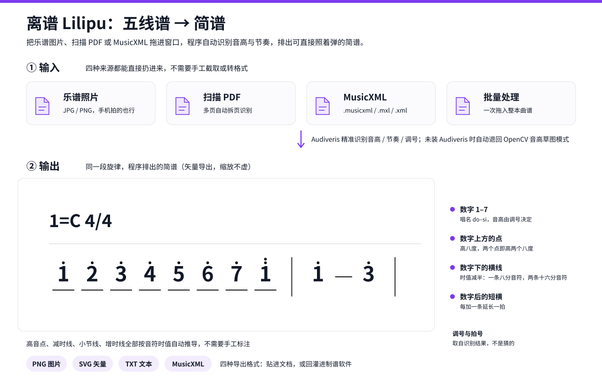

# 离谱 Lilipu

> 把五线谱图片 / PDF 转换成简谱文本与印刷级简谱图片的开源桌面工具。
>
> Staff-notation images / PDFs → 简谱 (jianpu) text and print-quality jianpu images.


Python 3.9+ · MIT License · Windows / macOS / Linux · 基于 [Audiveris](https://github.com/Audiveris/audiveris) + [music21](https://www.music21.org/)

---

## 能力边界（先读这段）

程序有两种识别模式，能力差别很大：

| 能力 | Audiveris 模式 | OpenCV 音高草图模式 |
|---|---|---|
| 安装要求 | 需额外安装 Audiveris | 开箱即用 |
| 音高 | ✅ | ✅ 按纵向位置估算 |
| 调号 / 升降号 | ✅ | ❌ |
| 节奏时值 / 小节线 | ✅ | ❌ |
| 和弦标记 | ✅ | ❌ |
| MusicXML 导出 | ✅ | ❌ |

**OpenCV 模式只给音高轮廓草图，不是完整简谱。** 想要可用结果请安装 Audiveris，程序会自动切换到高精度模式。



## 快速上手

1. 到 [Releases](../../releases) 下载 `Lilipu.exe`，双击运行（想要完整识谱先装 [Audiveris](https://github.com/Audiveris/audiveris/releases)，自带 Java）；
2. 把乐谱照片、扫描 PDF 或 MusicXML 拖进窗口，选引擎后点「开始转换」；
3. 预览无误后导出 PNG / SVG / TXT；要接着改谱就导出 MusicXML，拖进 MuseScore 即可。

上面那张图就是程序的真实输出：左边是排好的简谱，右边标了每个符号的含义。

## 功能

- 批量导入图片（JPG / PNG / BMP / TIFF），支持**多页 PDF 自动拆页**
- Audiveris OMR → MusicXML → 简谱文本，处理调号、拍号、升降号、延音线、连音线
- 印刷级简谱渲染：PNG / SVG，多页排版、换行、小节线、高音点、减时线、增时线
- 一键移调、MIDI 演奏、自动修复明显错误
- 导出 TXT / PNG / SVG / **MusicXML**（可直接拖进 MuseScore 再编辑）
- 历史记录（最近 100 条）、可点击查看的引擎状态提示

## 下载与安装

### 方式一：下载打包版（推荐）

到 [Releases](../../releases) 页面下载 `Lilipu.exe`（Windows）。首次运行前建议先装 Audiveris：

1. 从 [Audiveris Releases](https://github.com/Audiveris/audiveris/releases) 下载安装包（自带 Java，无需另装 JDK）；
2. Windows 装到默认路径 `C:\Program Files\Audiveris`；macOS / Linux 装好后确保 `audiveris` 在 `PATH` 中；
3. 重启 Lilipu，标题右上角会显示「引擎: Audiveris 高精度识别引擎」。

### 方式二：源码运行

```bash
git clone https://github.com/66SHUN66/staff-to-jianpu.git
cd staff-to-jianpu
python -m venv .venv
# Windows
.venv\Scripts\activate
# macOS / Linux
source .venv/bin/activate

pip install -r requirements.txt
python main.py
```

> Linux 下若 OpenCV 报缺少系统库，执行 `sudo apt install libgl1 libglib2.0-0`。

## 使用

1. 点「添加图片」，可一次选多张图片或一个 PDF（PDF 会按页拆开并按页码排序）；
2. 点「开始识别」，等待进度条走完；
3. 在「文本」视图看简谱，在「图片」视图看印刷版简谱；
4. 按需「复制」「导出TXT」「导出PNG」「导出SVG」「导出MusicXML」，或用「移调」上下移动音级。

示例图片放在 `assets/examples/`，点「示例」按钮即可加载（不再读取桌面文件）。

## 目录结构

```
.
├─ main.py                  # 入口
├─ lilipu/
│  ├─ __init__.py           # 版本与产品标识（唯一版本来源）
│  ├─ paths.py              # 跨平台数据目录、临时清理、打包资源定位
│  ├─ logging_setup.py      # 日志
│  ├─ core/
│  │  ├─ environment.py     # 引擎探测（Audiveris / OpenCV）
│  │  ├─ preprocess.py      # OpenCV 图像预处理
│  │  ├─ audiveris.py       # OMR 调用
│  │  ├─ converter.py       # MusicXML → 简谱核心算法
│  │  ├─ fallback.py        # OpenCV 音高草图
│  │  ├─ pdfinput.py        # PDF 拆页
│  │  └─ pipeline.py        # 批处理流水线
│  ├─ render/               # 印刷级简谱渲染
│  │  ├─ fonts.py           # 跨平台字体查找
│  │  ├─ layout.py          # 排版引擎
│  │  └─ print_renderer.py  # PNG / SVG 输出
│  └─ ui/app.py             # Tkinter 界面
├─ assets/                  # 图标、示例、可选字库
├─ docs/index.html          # 项目介绍页（GitHub Pages 可用）
├─ scripts/build.py         # PyInstaller 打包
├─ tests/                   # pytest
└─ .github/workflows/       # CI + Windows 打包发布
```

## 打包

```bash
pip install -r requirements-dev.txt
python scripts/build.py        # 产物在 dist/Lilipu.exe
```

体积说明：

- 依赖使用 `opencv-python-headless`（不带 GUI/Qt），比 `opencv-python` 明显更小；
- `scripts/lilipu.spec` 排除了 pandas / scipy / PyQt 等用不到的模块；
- 若打包后启动报缺模块，把报错模块名从 spec 的 `excludes` 里删掉再打包即可。

也支持在 GitHub Actions 里构建：`.github/workflows/build-windows.yml` 在推 `v*` 标签、修改 CHANGELOG 或打包配置时自动产出 exe 并挂到 Release。

## 测试

```bash
pip install -r requirements-dev.txt
pytest -q
```

测试覆盖：渲染输出尺寸与像素非空白、MusicXML → 简谱的端到端转换、数据目录与临时清理逻辑、字体查找。

## 常见问题

**识别慢？** Audiveris 单页一般 10–20 秒，取决于图片分辨率与谱面复杂度。

**识别不准？** 先确认图片清晰、没有明显倾斜；OpenCV 模式本身只输音高，建议安装 Audiveris。

**日志在哪？** Windows：`%APPDATA%\Lilipu\debug.log`；macOS：`~/Library/Application Support/Lilipu/`；Linux：`~/.local/share/Lilipu/`。旧版 `ScoreConverter` 目录下的历史记录会在首次启动时自动迁移。

**字体显示成方块？** 程序会依次尝试随包字库（`assets/fonts/`）→ 系统中文字体 → matplotlib 字体索引。也可以设置环境变量 `LILIPU_FONT` 指向一个 ttf/otf 文件。

**临时文件堆在哪儿？** `%TEMP%\lilipu\`，每次启动会自动清理 7 天前的产物。

## 致谢

- [Audiveris](https://github.com/Audiveris/audiveris) — 光学识谱引擎
- [music21](https://www.music21.org/) — MusicXML 解析与乐理分析
- [OpenCV](https://opencv.org/) / [Pillow](https://python-pillow.org/) / [PyMuPDF](https://pymupdf.readthedocs.io/)

## License

[MIT](LICENSE)
